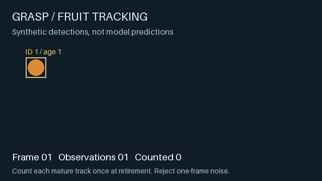
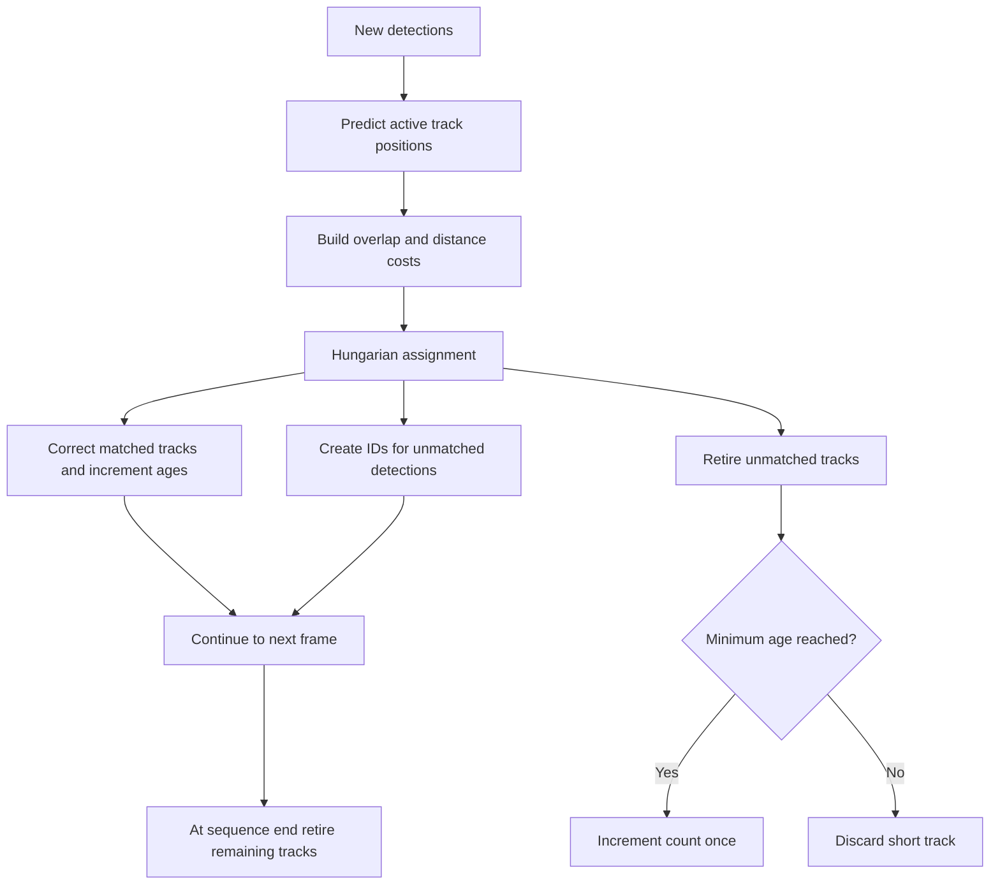

# GRASP Lab · Agricultural vision and fruit counting

[](https://github.com/Jaiashar/grasp-fruit-counting/actions/workflows/checks.yml)

**From orchard images to pixel masks, persistent tracks, and fruit counts.** A curated source release from the KumarAg agricultural-vision research codebase, with a runnable extract of its tracking primitives.

I’m **Jai Ashar**. At Penn’s [GRASP Lab](https://www.grasp.upenn.edu/), I worked on computer-vision models and fruit-counting research. This repository makes substantive code from that team research accessible alongside an explanation of how it works. It includes the historical agricultural FCN implementation, selected tracking modules, and a new synthetic demonstration with automated checks.

This was collaborative research. The tracking modules credit **Chao Qu**, the full historical tracker credits **Chao Qu and Xu Liu**, and the segmentation subtree retains **Sarath Shekkizhar’s** upstream MIT license. My research role does not imply sole authorship of these implementations. See [provenance and credits](PROVENANCE.md) for the exact source snapshot and release changes.

## See the counting logic



The demo contains **28 frame observations, two persistent fruits, and one single-frame distractor**. It changes detection order across frames, associates detections with track IDs, and counts each qualifying track when it retires. The resulting count is **2**.

These are generated shapes with supplied bounding boxes, **not neural-network predictions or field results**. The demo exercises the extracted Kalman, bounding-box cost, and Hungarian-assignment code. Optical flow has a separate test using a known image translation. Training and model inference are not part of this demo.

## Why tracking matters

Adding detections from consecutive orchard images counts the same fruit repeatedly. The research instead combines spatial recognition with temporal association: segment fruit pixels, maintain identities as the camera moves, and count tracks that survive long enough to reject brief noise.

```mermaid
flowchart LR
    Images[Orchard imagery] --> Labels[Annotation and masks]
    Labels --> Train[Train a fully convolutional network]
    Train --> Masks[Pixel-level fruit masks]
    Masks -. Detection extraction .-> Detections[Frame detections]
    Detections --> Tracking[Motion prediction and association]
    Tracking --> Identities[Track identities and ages]
    Identities --> Counts[Count mature tracks]
```



This is an architectural overview of the research components. The dashed step marks the mask-to-detection interface; this release does not assemble a complete image-to-count application. The public [AgDSS annotation project](https://github.com/Trefo/agdss) is a related team component. The runnable example here starts at supplied frame detections.

## Inside the implementation

### Pixel-level segmentation

The historical [FCN model](historical/segmentation/FCN.py) uses TensorFlow 1.x and VGG-19 initialization. The agricultural variant has **two output classes**. It subtracts mean pixel values, extracts convolutional features, fuses intermediate `pool4` and `pool3` features with coarse predictions, and uses transposed convolutions to restore spatial resolution.

Training uses sparse softmax cross-entropy and Adam. Inference restores a checkpoint and takes the highest-scoring class at each pixel. The [inference entry point](historical/segmentation/FCNInference.py), data readers, and TensorFlow helpers are included unchanged for inspection. They retain legacy APIs and machine-specific paths; they are not installed or run by the modern package.

### Motion, assignment, and counting

| Component | What the code does |
| --- | --- |
| [Kalman filter](src/scpye/track/kalman_filter.py) | Maintains `[x, y, vx, vy]` under a constant-velocity model, predicts position, and corrects it using measurements. Uses the Joseph covariance update. |
| [Optical flow](src/scpye/track/optical_flow.py) | Wraps OpenCV pyramidal Lucas-Kanade flow and averages valid displacements. The compatibility update preserves array shapes for a single point and handles empty or failed results. |
| [Bounding-box costs](src/scpye/track/bounding_box.py) | Combines overlap and normalized center distance to score candidate associations. |
| [Hungarian assignment](src/scpye/track/assignment.py) | Solves a padded assignment problem, returning matches, unmatched tracks, and unmatched detections. Uses SciPy in place of the removed scikit-learn private API. |
| [Fruit track](src/scpye/track/fruit_track.py) | Holds the filter, bounding box, position history, and age of each track. |
| [Original full tracker](historical/tracking/fruit_tracker.py) | Preserves the historical integration of image processing, optical flow, association, and counting for source inspection. It is not the runnable demo wrapper. |

The pairwise assignment cost is `(1 - IoU) + squared_center_distance / (2 * (area_a + area_b))`. The padded solver charges an unassignment cost for **each** unmatched endpoint. Leaving a track and detection both unmatched therefore costs twice that value; it is not a simple one-sided distance threshold.



This second diagram describes the **new demo harness**. Its minimum age is three observations. It retires a track on the first missed frame, so occlusion or re-entry can split an identity and overcount. It is intentionally small enough to inspect and is not a production counting system or an exact port of the full historical tracker.

## Run it locally

Requires Python 3.11 or later. No credentials, datasets, model downloads, or external services are needed for the tracking demo.

```bash
python3 -m venv .venv
source .venv/bin/activate
python -m pip install -e .
python -m unittest discover -s tests -v
python -m examples.synthetic_demo
```

The last command writes `outputs/synthetic-tracking.gif` and a PNG preview. Run these commands from the repository root so Python can import the `examples` module.

GitHub Actions runs the tests and regenerates the demo on Python 3.11 and 3.12. The checks cover rectangular and empty assignments, unassignment costs, invalid inputs, Kalman correction and covariance, single-point optical flow under known translation, rejection of brief noise, stable counting despite shuffled detections, and idempotent finalization.

## Scope and reproducibility

- **Runnable:** five extracted tracking modules, a synthetic demonstration, and automated tests. Three tracking modules are byte-for-byte copies; assignment and optical flow have documented compatibility fixes.
- **Historical source:** 11 segmentation files and the original full tracker. These preserve the research implementation, including its legacy dependencies and paths.
- **Not included:** orchard datasets, annotations, trained checkpoints, serialized outputs, mobile services, and the original repository’s private history.

No accuracy, yield-estimation, or field-performance claims are made from this release. Reproducing the model would require the matching data, labels, weights, and a reconstructed legacy environment. The synthetic result verifies specific tracking behavior, not research performance.

## Credits and licenses

This release is curated under [Jai Ashar’s portfolio](https://github.com/Jaiashar), with original team and upstream credit preserved. The root [Apache 2.0 license](LICENSE) comes from KumarAg. The segmentation subtree retains its separate [MIT license](historical/segmentation/LICENSE). New demo, test, and release tooling is Apache 2.0 licensed. [PROVENANCE.md](PROVENANCE.md) identifies the original paths, authors, and modifications; the [manifest](provenance-manifest.json) records source and released-file hashes.
